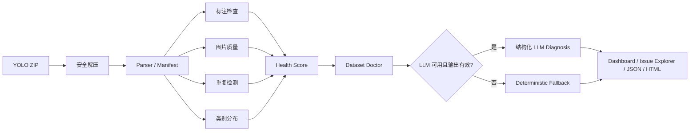

# VisionDoctor

VisionDoctor 是一个面向黑客松演示的 **AI 视觉数据集体检与修复决策 Agent**。用户上传 YOLO Detection 格式 ZIP 后，系统在临时目录中完成安全解压、数据解析、规则检查、Health Score、结构化诊断以及 JSON/HTML 报告生成。项目不训练模型，也不会自动修改原始图片或标签。

## 已实现功能

- ZIP 安全检查：拒绝非 ZIP、损坏包、绝对路径、路径穿越、软链接、超限文件和可疑压缩比。
- YOLO Detection 解析：支持 `names` 列表或整数键字典，按相对路径和 stem 匹配图片与标签。
- 标注检查：缺失/孤立/空标签、解析错误、非法类别、非正/越界/跨边界/极小框。
- 图片质量检查：不可读、模糊、过暗、过亮和低分辨率。
- 图片质量阈值：默认保持固定阈值，也可按 split 使用中位数、MAD/IQR
  和安全上下限自适应校准；样本不足时自动回退固定阈值。
- 重复检测：SHA-256 完全重复和 pHash 近似重复，并区分同 split
  重复与跨 train/val/test 的 exact/near 泄漏候选。
- bbox 统计检查：按类别检测面积和长宽比离群候选，小样本类别不下结论。
- 类别分布：实例数、覆盖图片数、零实例、稀有类别和失衡指数。
- 可解释 Health Score、单一 Dataset Doctor、受控只读证据查询与确定性事实校验；无 Key 时使用 deterministic fallback。
- 本地版本化场景知识包：generic、industrial inspection、retail detection 和 small-object detection。
- 单页 Streamlit Dashboard、Issue Explorer，以及 JSON/HTML 下载。

## 数据流



核心 Pipeline 与 Streamlit 解耦，不依赖数据库。LLM 只接收聚合统计、Issue 分组、分数、类别分布和少量代表性证据，不接收图片、完整标签或完整数据集。

## 用大白话说明：VisionDoctor 怎么工作

把 VisionDoctor 想成“训练前的数据集体检中心”。用户不用先训练模型，只要把符合约定目录的 YOLO Detection 数据集打成 ZIP，然后按下面这条链路操作：

1. **先把 ZIP 安全地打开。** 系统先检查它是不是真正的 ZIP，有没有路径穿越、绝对路径、软链接、异常压缩比或超大文件。通过以后，才会解压到随机临时目录，而且不会执行压缩包里的任何内容。
2. **看懂数据集。** 系统读取 `data.yaml`，找到 train/val/test 下的图片和标签，按相对路径配对。某一行标签写坏了，会把错误留下来继续检查，不会因为一行坏数据让整次任务崩溃。
3. **做五类体检。** 检查缺失/空/损坏标签、非法类别和边界框；测量模糊、亮度和分辨率；找完全重复与近似重复图片；检查跨 split 泄漏；统计类别数量、覆盖图片和类别内 bbox 离群。
4. **把问题变成可解释分数。** Health Score 从 100 分开始，按结构、bbox、图片、重复和类别分布五类风险扣分，每类都有上限。它是数据风险提示，不是模型精度预测。
5. **预演“如果修了会怎样”。** 系统可以在内存中假设某类问题已经解决，再重新计算健康分。它不会改源文件，也不会承诺 mAP 一定提升。
6. **让 Dataset Doctor 给出处理顺序。** 有 Key 时，单一 Agent 只能查询有限的只读证据，并且输出必须通过 Pydantic 和事实校验；没有 Key 或调用失败时，确定性 fallback 仍会给出完整建议。
7. **结合应用场景解释。** 用户可以选择通用、工业质检、零售检测或小目标检测知识包。知识包只提供复核思路，不能覆盖前面检查器产生的事实。
8. **最后把结果交给人。** 页面展示健康看板、问题证据、重复组、AI/确定性诊断和修复预演，并可下载可复查的 JSON 与自包含 HTML 报告。

### 需求应答

| 用户需求 | VisionDoctor 的应答 |
|---|---|
| 数据集能否安全上传？ | 限制 ZIP 大小、条目数、单文件大小、总解压量和压缩比，并拒绝危险路径与软链接。 |
| 标签哪里有问题？ | 输出稳定 Issue ID、问题代码、文件、行号、bbox、测量值、阈值和建议动作。 |
| 图片是否适合训练？ | 提供模糊、过暗、过亮、低分辨率和不可读检测，并保留实际测量证据。 |
| 数据是否重复或泄漏？ | SHA-256 查完全重复，pHash 查近似重复，并单独标记跨 train/val/test 的泄漏候选。 |
| 类别是否健康？ | 统计实例数、覆盖图片、零实例、稀有类别、失衡指数和类别内 bbox 离群。 |
| 没有 API Key 能否演示？ | 可以。完整 Pipeline、健康分、确定性诊断和报告都不依赖外部 API。 |
| 建议是否可信？ | LLM 只能读取受限证据，数量、分数、Issue ID 和禁止性承诺会被二次校验；失败即回退。 |
| 会不会自动改坏原数据？ | 不会。系统只读分析，修复影响也是内存中的假设预演。 |

### 可用于答辩的创新点

- **检测和建议分层。** checker 负责事实，知识包和 Dataset Doctor 负责建议，避免把 LLM 说法伪装成检测结论。
- **受控证据查询 Agent。** 仍然只有一个 Agent，但它不是一次性“看摘要说答案”，而是在轮数和字节上限内查询 8 个只读工具，再接受事实校验。
- **固定阈值与稳健自适应并存。** 自适应模式按 split 使用 median、MAD/IQR，并在样本不足或分布退化时回退固定阈值。
- **跨 split 泄漏和类别内 bbox 离群。** exact/near 重复证据与 train/val/test 边界结合；bbox 使用类别内稳健统计，减少把合法小目标误判为异常的风险。
- **可校验的健康分和修复预演。** Score Profile 有版本、封顶和单调性检查，what-if 预演不改文件，也不把分数变化说成模型收益。
- **带 Ground Truth 的合成 Benchmark。** 缺陷由固定种子注入并按路径、行号和重复组匹配，不只是比较 Issue 数量；但它仍是合成验证，不能冒充真实业务效果。
- **无 Key 也完整可用。** deterministic fallback 与 LLM 使用同一报告和知识包，不会因为外部服务不可用而丢失核心功能。

当前没有真实视觉基础模型或视觉 embedding 离群模块；不能把规则检查、pHash 或 fake backend 描述成真实视觉模型验证。

Dataset Doctor 仍是单一 Agent。支持工具协议的客户端先接收最小概览，并可在默认最多 3 轮内查询 8 个只读证据接口；每轮调用数、单次结果项数、单次响应字节数和累计证据量均受配置上限约束。证据服务只读取已构造的 `AuditReport`，不接受任意路径、URL、命令或代码。

## 场景化数据质量知识库

Upload 页可以选择 `generic`（默认）、`industrial_inspection`、`retail_detection` 或 `small_object_detection`。每个知识包都是仓库内固定注册、版本为 `1.0.0` 的 YAML，并在加载时通过 Pydantic Schema 校验。用户选择只能映射到固定枚举和固定文件名；未知值安全回退到 generic，类别名、文件路径和数据集文本不会参与知识包路径解析或被当作指令。

检索只使用 AuditReport 中的 Issue code、类别分布、bbox/图片质量统计信号、split leakage 和修复预演。返回条目、问题和文本长度均有限制，结果稳定记录：

- 选中的 profile 与显示名；
- 知识包 schema 版本；
- 实际使用的 guidance entry ID；
- source/provenance、建议问题和 caveats；
- “指导信息不是检测事实”的固定免责声明。

知识包是项目编写的通用审查指导，不包含未经验证的行业数字或性能承诺。JSON/HTML 将知识建议放在独立字段/章节中，不能覆盖 deterministic checker 的检测事实。LLM 和无 Key deterministic fallback 使用报告中同一份已检索知识上下文；fallback 不会因为缺少 Key 而丢失场景化建议。所有建议仍需人工确认，也不代表已经修改数据或能够提高 mAP。

## 支持的数据集结构

```text
dataset/
├── train/
│   ├── images/
│   └── labels/
├── val/                   # 可选
│   ├── images/
│   └── labels/
├── test/                 # 可选
│   ├── images/
│   └── labels/
└── data.yaml
```

`train` 必须存在；`val` 和 `test` 可选，但一旦出现就必须同时包含 `images/` 与 `labels/`。ZIP 可以直接以数据集内容为根，也可以有一个外层目录（例如 `dataset/`）。系统通过唯一的 `data.yaml` 定位数据集根，允许 ZIP 根和数据集根包含 README、许可证、JSON、二进制说明文件等其他普通文件；多个真实 `data.yaml` 会因无法安全确定目标数据集而被拒绝。图片和标签在同一 split 内按相对于各自 `images/`、`labels/` 的路径和 stem 配对。

图片格式支持 JPG、JPEG、PNG、BMP 和 WEBP；标签行为 `class_id x_center y_center width height`。旧式 `images/train`、`labels/train` 布局不再属于支持范围。不支持 COCO、分割、姿态或训练流程。

## 安装

要求 Python 3.10+。在仓库根目录执行：

```powershell
python -m venv .venv
.\.venv\Scripts\Activate.ps1
python -m pip install --upgrade pip
python -m pip install -r requirements.txt
```

需要运行测试和 Ruff 时，再安装开发依赖：

```powershell
python -m pip install -r requirements-dev.txt
```

macOS/Linux 激活命令为 `source .venv/bin/activate`，其余命令相同。

## 本地运行

```powershell
python -m streamlit run app.py --server.headless true
```

打开终端给出的本地地址。应用包含“上传体检、健康看板、问题定位、医生与报告”四个编号标签页。上传内容只在系统临时目录中处理；重新上传会清理上一份会话数据。

Demo 界面使用简体中文。样式由无第三方 npm 依赖的 Node.js 脚本确定性生成，Streamlit 运行时只读取仓库内的静态 CSS，不需要 Node.js：

```powershell
node scripts/build_ui_theme.mjs --check
# 修改脚本中的样式后需要重新生成时：
node scripts/build_ui_theme.mjs
```

## Demo 数据与冒烟测试

Demo 完全由本地脚本按固定随机种子生成，不下载互联网数据：

```powershell
python scripts/generate_demo_dataset.py
python scripts/smoke_test.py
```

生成文件为 `demo/visiondoctor_demo.zip`。它是被 `.gitignore` 忽略的派生产物，可直接在 Upload 标签页上传。详细场景见 [demo/README.md](demo/README.md)。

## 可控缺陷 Benchmark

阶段 10/11 的合成 Benchmark 由固定随机种子生成明确 Ground Truth，不从
检测输出反推标签，也不下载互联网数据：

```powershell
python scripts/run_corruption_benchmark.py --profile quick
python scripts/calibrate_health_score.py --profile quick
python scripts/run_corruption_benchmark.py --profile standard
```

`quick` 使用 40 张图片并同时运行 fixed/adaptive 两种图片质量模式；输出写入
被 Git 忽略的 `benchmarks/generated/`。指标按 Issue code、相对路径和标签行
匹配，重复组按完整成员匹配。该结果只代表合成注入场景，不等于真实业务数据
上的误报率、漏报率或模型收益。

校准脚本只读取已有 Benchmark 结果，比较候选权重的单调性、区分度与重复
稳定性，并把 JSON/Markdown 结果写入同一忽略目录。它不会修改生产配置。
`quick` 明确不足以推荐 `calibrated-v2`；候选只有在标准或规模 Benchmark、
检测指标、单调性、区分度和稳定性预设门槛全部满足时，才会被标记为
recommended candidate。即使满足，合成结果也不能替代真实业务校准。

## 可选 API Key 与 fallback

API Key 不是运行条件。默认关闭 LLM，完整流程会使用 deterministic fallback：

```powershell
Copy-Item .env.example .env
```

如需 DeepSeek，将 `.env` 中 `VISION_DOCTOR_LLM__ENABLED` 改为 `true`，并只在本机填写 Key；不要提交 `.env`。DeepSeek 地址固定限制为官方 HTTPS origin `https://api.deepseek.com`。UI 中还需主动勾选外部 LLM，才可能发起请求并产生费用。

未配置 Key、LLM 被禁用、SDK 缺失、超时、网络/API 错误、非 JSON 或 Schema 校验失败时，系统均返回同一 `Diagnosis` 类型的 deterministic fallback。mock 已验证 DeepSeek 的 OpenAI-compatible 接口；2026-10-19 还使用本地环境变量中的凭证对官方 API 完成了一次 opt-in 实时验证，返回 `generated_by=llm` 且通过 Pydantic 校验。真实调用仍是可选路径，不影响无 Key 演示。

证据查询模式提供 `get_dataset_summary`、`get_issue_group`、`get_representative_issues`、`get_class_distribution`、`get_score_component`、`get_duplicate_summary`、`get_split_leakage_summary` 和 `get_repair_simulations`。LLM 输出中的数值事实通过结构化 `evidence_claims` 声明；系统会确定性核对 Issue ID、数量、Health Score/扣分、类别实例、重复/泄漏组、finding severity、critical Issue 覆盖以及禁止性的 mAP 承诺或“已修改数据”声明。校验失败不会保留为 LLM 成功，而会记录脱敏失败阶段并回退。Provider 不支持工具协议时使用原有的受限一次性聚合 Prompt；这不是 Multi-Agent。

阶段 13 只使用 fake/mock 客户端验证工具协议和校验回退，没有执行新的真实 DeepSeek 请求。README 中上段 2026-10-19 的实时验证是更早版本的独立历史事实，不能作为当前证据查询循环的远程兼容性证据。

## 测试与静态检查

```powershell
python scripts/generate_demo_dataset.py
python scripts/smoke_test.py
python -m pytest -q
python -m ruff check .
python -m compileall app.py src scripts
git diff --check
git status --short
```

服务启动检查：

```powershell
python -m streamlit run app.py --server.headless true
```

确认本地页面可访问后用 `Ctrl+C` 正常停止。

## Streamlit Community Cloud 部署

1. 先运行上面的完整验证，确认 `.env`、生成 ZIP、上传数据和报告不在 `git status` 中。
2. 将代码提交并推送到你有管理权限的 GitHub 仓库；不要提交 `.env` 或 `.streamlit/secrets.toml`。
3. 登录 [Streamlit Community Cloud](https://share.streamlit.io/)，连接 GitHub，创建应用并选择仓库、分支及入口 `app.py`。
4. 在 Advanced settings 选择与本地一致的 Python 版本。根目录的 `requirements.txt` 会提供依赖。
5. 无 Key 可直接部署。若启用 DeepSeek，在 Secrets 中以 TOML 根级键配置环境变量；根级 Streamlit secrets 可作为环境变量读取：

   ```toml
   "VISION_DOCTOR_LLM__ENABLED" = "true"
   "VISION_DOCTOR_LLM__PROVIDER" = "deepseek"
   "VISION_DOCTOR_LLM__MODEL" = "deepseek-flash"
   "VISION_DOCTOR_LLM__BASE_URL" = "https://api.deepseek.com"
   "VISION_DOCTOR_LLM__API_KEY" = "replace-with-real-key-in-cloud-console"
   ```

6. 部署后人工上传 Demo ZIP，检查四个标签页和两种报告下载，再提交公开 Demo URL。

Community Cloud 从仓库根目录运行应用，入口与依赖文件的当前布局符合其要求。部署操作和公网 URL 不属于本地验收证据，本仓库不会自动部署。

## 隐私与 ZIP 安全

- 上传文件保存在随机系统临时目录，不写入仓库或数据库；会话替换和正常释放时清理。
- 解压前后限制归档大小、条目数、单文件大小、总大小和压缩比，并拒绝路径穿越、绝对路径及软链接。
- 压缩包内容只作为数据读取，绝不执行其中的文件。
- LLM 路径不上传图片、完整标签、完整 Issue 列表或完整数据集。
- 进程被强制终止时，操作系统临时目录可能需要稍后清理；敏感数据仍不应上传到不受信任的主机。

## Health Score

```text
score = 100
      - structural_penalty   (上限 25)
      - bbox_penalty         (上限 20)
      - image_penalty        (上限 20)
      - duplicate_penalty    (上限 15)
      - distribution_penalty (上限 20)
```

总分限制在 0–100。空标签仅作提示，不自动扣分；单类别数据集的 distribution penalty 为 0。报告同时给出原始比例、分项扣分、阈值快照和计算说明。

评分规则封装为版本化 Score Profile。默认 `legacy-v1` 完全保持原有五类比例与
封顶扣分行为，并在 `HealthScore` 中记录方法版本、profile、penalty caps、原始
比例、校准元数据和限制。`calibrated-v2` 默认关闭，不能由一次 Demo 或 quick
Benchmark 自动启用。

跨 split 泄漏和 bbox 统计离群是额外证据候选，当前不自动增加 Health Score
扣分，避免未经真实数据校准就改变既有评分语义。near duplicate 和统计离群均
需要人工确认。

Health Score 是启发式数据风险指标，不是模型精度预测、真实性证明或训练成功保证。类别不平衡和空标签可能符合业务语义，阈值及结论必须由领域人员复核，也不能据此保证修复后 mAP 提升。

JSON、HTML 和 UI 会展示最多 5 个确定性的“假设修复影响”情景。预演只在内存
中假设选定 Issue、Issue code、重复组、不可读图片或跨 split 泄漏已解决，再用
同一 Score Profile 重新计分；不会修改 ZIP、图片或标签。显示的 current score、
simulated score 和 delta 是风险指标的 what-if 结果，不表示修复已执行，也不预测
mAP、训练效果或商业收益。工作量仅使用 low/medium/high，存在依赖的情景明确
要求人工确认。

## 三分钟演示流程

1. 约 30 秒：运行 Demo 生成命令并启动 Streamlit。
2. 约 30 秒：在 Upload 页说明 YOLO 格式、安全限制和临时处理，上传 Demo ZIP 并开始体检。
3. 约 45 秒：在 Dashboard 展示 Health Score、严重度、类别分布、扣分和图片质量。
4. 约 45 秒：在 Issue Explorer 筛选框问题、图片质量问题，查看证据与 exact/near 重复组。
5. 约 30 秒：在 AI Doctor & Report 展示 fallback/LLM 来源、行动计划，并下载 JSON 与 HTML。

## 截图占位说明

仓库当前没有伪造或预置产品截图。提交前请基于实际运行结果自行截取 Upload、Dashboard、Issue Explorer 和 AI Doctor & Report 四张图，可放入 `docs/screenshots/` 后再在此处添加图片链接；截图前请确认画面不含本机路径、Key 或私有数据。

## 已知限制

- 仅支持约定的 YOLO Detection 目录结构；不支持 COCO、分割和姿态。
- pHash 近重复采用简单两两比较，默认最多处理 2,000 张图片，规模增大时复杂度约为 O(n²)。
- adaptive 图片阈值依赖 split 内样本分布，默认至少需要 12 张可解码图片；
  严重污染、领域分布差异和近阈值样本仍可能产生误报或漏报。
- bbox 离群默认每类至少需要 10 个有效框，只表示统计候选；合法的小目标或
  极端长宽比类别仍需领域人员确认。
- 当前 Score 校准只有合成 quick Benchmark 证据，尚未执行 standard/scale 或真实
  业务数据校准，因此 `calibrated-v2` 未达到推荐条件，运行时继续使用
  `legacy-v1`。
- 修复影响预演只删除或调整内存中的评分证据；它不建模所有问题间的因果关系，
  也不会验证实际修复后的数据或模型表现。
- HTML 报告不嵌入原图，Issue 很多时文件大小线性增长；报告渲染需要额外内存。
- 图片预览遇到损坏文件或 ZIP 内不唯一的后缀匹配时会安全拒绝显示。
- 没有用户系统、数据库、自动修标、训练、重新训练或 Multi-Agent。
- 证据查询工具调用与事实校验已通过 mock 测试，但尚未对真实 DeepSeek 工具调用执行阶段 13 的 opt-in 网络验证；不支持 tools 的 Provider 会安全退回一次性聚合 Prompt。
- 场景知识包是本地通用指导，尚未由具体行业客户、业务数据或外部标准进行领域验证；它不会替代标注规范和领域专家判断。
- 浏览器文件选择、下载对话框和最终视觉排版仍需要人工验收。
- 公共 Streamlit Demo 已部署；云端默认不配置 Key，因此使用 deterministic fallback。真实 DeepSeek API 仅在本地 opt-in 验证中成功返回过 `generated_by=llm`，不代表服务可用性或输出质量保证。

## 可扩展方向

在保持检测事实与决策层解耦的前提下，后续可考虑增加大规模重复检索索引、可配置规则集、人工确认与修复导出、更多报告可视化、CI 质量门禁，以及经独立安全设计后的其他标注格式适配。这些均不属于当前 MVP。

## 项目结构

```text
app.py                       Streamlit 入口
src/vision_doctor/           核心模型、解析、检查、评分、Agent、报告与 UI
scripts/                     Demo 生成、冒烟测试和 opt-in API 验证
tests/                       自动化测试
demo/README.md               Demo 数据说明
docs/MVP_SPEC.md             产品契约
docs/IMPLEMENTATION_STATUS.md 实施与验证记录
```
