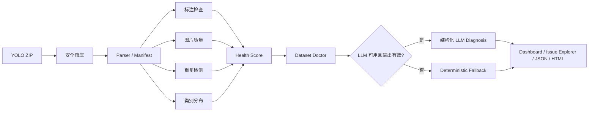

# VisionDoctor

VisionDoctor 是一个面向黑客松演示的 **AI 视觉数据集体检与修复决策 Agent**。用户上传 YOLO Detection 格式 ZIP 后，系统在临时目录中完成安全解压、数据解析、规则检查、Health Score、结构化诊断以及 JSON/HTML 报告生成。项目不训练模型，也不会自动修改原始图片或标签。

## 已实现功能

- ZIP 安全检查：拒绝非 ZIP、损坏包、绝对路径、路径穿越、软链接、超限文件和可疑压缩比。
- YOLO Detection 解析：支持 `names` 列表或整数键字典，按相对路径和 stem 匹配图片与标签。
- 标注检查：缺失/孤立/空标签、解析错误、非法类别、非正/越界/跨边界/极小框。
- 图片质量检查：不可读、模糊、过暗、过亮和低分辨率。
- 重复检测：SHA-256 完全重复和 pHash 近似重复。
- 类别分布：实例数、覆盖图片数、零实例、稀有类别和失衡指数。
- 可解释 Health Score、单一 Dataset Doctor、无 Key deterministic fallback。
- 单页 Streamlit Dashboard、Issue Explorer，以及 JSON/HTML 下载。

## 数据流



核心 Pipeline 与 Streamlit 解耦，不依赖数据库。LLM 只接收聚合统计、Issue 分组、分数、类别分布和少量代表性证据，不接收图片、完整标签或完整数据集。

## 支持的数据集结构

Split-first（`train` 必需，`val`/`test` 可选）：

```text
dataset/
├── train/
│   ├── images/
│   └── labels/
├── val/                  # 可选
│   ├── images/
│   └── labels/
├── test/                 # 可选
│   ├── images/
│   └── labels/
└── data.yaml
```

Images-first：

```text
dataset/
├── images/
│   ├── train/
│   ├── val/              # 可选
│   └── test/             # 可选
├── labels/
│   ├── train/
│   ├── val/              # 可选
│   └── test/             # 可选
└── data.yaml
```

Flat 小数据集也可使用同级 `images/`、`labels/` 和 `data.yaml`。ZIP 可以直接以数据集内容为根，也可以有一个外层目录（例如 `dataset/`）。系统通过唯一的 `data.yaml` 定位数据集根，允许 ZIP 根和数据集根包含 README、许可证、`.DS_Store` 等其他普通文件，并忽略 `__MACOSX` 中的元数据 YAML；多个真实 `data.yaml` 会因无法安全确定目标数据集而被拒绝。

`data.yaml` 的 `names` 必需，支持列表或从 0 开始的连续整数键字典；`nc` 可省略，存在时必须与 `names` 数量一致。`path`、`train`、`val`、`test` 支持数据集根内的相对本地目录；URL、绝对路径、UNC/盘符路径和越界路径会被拒绝。显式 split 路径优先，未配置时才进行 split-first、images-first、flat 三种布局的无歧义自动识别。缺少 `labels/` 不会阻断图片分析，而会产生逐图 `LABEL_MISSING` 供人工确认。图片和标签在同一 split 内按相对路径和 stem 配对。

图片格式支持 JPG、JPEG、PNG、BMP 和 WEBP；标签行为 `class_id x_center y_center width height`。不支持 COCO、分割、姿态或训练流程。

## 安装

要求 Python 3.10+。在仓库根目录执行：

```powershell
python -m venv .venv
.\.venv\Scripts\Activate.ps1
python -m pip install --upgrade pip
python -m pip install -r requirements.txt
```

需要运行测试和 Ruff 时，再安装开发依赖：

```powershell
python -m pip install -r requirements-dev.txt
```

macOS/Linux 激活命令为 `source .venv/bin/activate`，其余命令相同。

## 本地运行

```powershell
python -m streamlit run app.py --server.headless true
```

打开终端给出的本地地址。应用包含 Upload、Dashboard、Issue Explorer、AI Doctor & Report 四个标签页。上传内容只在系统临时目录中处理；重新上传会清理上一份会话数据。

## Demo 数据与冒烟测试

Demo 完全由本地脚本按固定随机种子生成，不下载互联网数据：

```powershell
python scripts/generate_demo_dataset.py
python scripts/smoke_test.py
```

生成文件为 `demo/visiondoctor_demo.zip`。它是被 `.gitignore` 忽略的派生产物，可直接在 Upload 标签页上传。详细场景见 [demo/README.md](demo/README.md)。

## 可选 API Key 与 fallback

API Key 不是运行条件。默认关闭 LLM，完整流程会使用 deterministic fallback：

```powershell
Copy-Item .env.example .env
```

如需 DeepSeek，将 `.env` 中 `VISION_DOCTOR_LLM__ENABLED` 改为 `true`，并只在本机填写 Key；不要提交 `.env`。DeepSeek 地址固定限制为官方 HTTPS origin `https://api.deepseek.com`。UI 中还需主动勾选外部 LLM，才可能发起请求并产生费用。

未配置 Key、LLM 被禁用、SDK 缺失、超时、网络/API 错误、非 JSON 或 Schema 校验失败时，系统均返回同一 `Diagnosis` 类型的 deterministic fallback。mock 已验证 DeepSeek 的 OpenAI-compatible 接口；2026-10-19 还使用本地环境变量中的凭证对官方 API 完成了一次 opt-in 实时验证，返回 `generated_by=llm` 且通过 Pydantic 校验。真实调用仍是可选路径，不影响无 Key 演示。

## 测试与静态检查

```powershell
python scripts/generate_demo_dataset.py
python scripts/smoke_test.py
python -m pytest -q
python -m ruff check .
python -m compileall app.py src scripts
git diff --check
git status --short
```

服务启动检查：

```powershell
python -m streamlit run app.py --server.headless true
```

确认本地页面可访问后用 `Ctrl+C` 正常停止。

## Streamlit Community Cloud 部署

1. 先运行上面的完整验证，确认 `.env`、生成 ZIP、上传数据和报告不在 `git status` 中。
2. 将代码提交并推送到你有管理权限的 GitHub 仓库；不要提交 `.env` 或 `.streamlit/secrets.toml`。
3. 登录 [Streamlit Community Cloud](https://share.streamlit.io/)，连接 GitHub，创建应用并选择仓库、分支及入口 `app.py`。
4. 在 Advanced settings 选择与本地一致的 Python 版本。根目录的 `requirements.txt` 会提供依赖。
5. 无 Key 可直接部署。若启用 DeepSeek，在 Secrets 中以 TOML 根级键配置环境变量；根级 Streamlit secrets 可作为环境变量读取：

   ```toml
   "VISION_DOCTOR_LLM__ENABLED" = "true"
   "VISION_DOCTOR_LLM__PROVIDER" = "deepseek"
   "VISION_DOCTOR_LLM__MODEL" = "deepseek-flash"
   "VISION_DOCTOR_LLM__BASE_URL" = "https://api.deepseek.com"
   "VISION_DOCTOR_LLM__API_KEY" = "replace-with-real-key-in-cloud-console"
   ```

6. 部署后人工上传 Demo ZIP，检查四个标签页和两种报告下载，再提交公开 Demo URL。

Community Cloud 从仓库根目录运行应用，入口与依赖文件的当前布局符合其要求。部署操作和公网 URL 不属于本地验收证据，本仓库不会自动部署。

## 隐私与 ZIP 安全

- 上传文件保存在随机系统临时目录，不写入仓库或数据库；会话替换和正常释放时清理。
- 解压前后限制归档大小、条目数、单文件大小、总大小和压缩比，并拒绝路径穿越、绝对路径及软链接。
- 压缩包内容只作为数据读取，绝不执行其中的文件。
- LLM 路径不上传图片、完整标签、完整 Issue 列表或完整数据集。
- 进程被强制终止时，操作系统临时目录可能需要稍后清理；敏感数据仍不应上传到不受信任的主机。

## Health Score

```text
score = 100
      - structural_penalty   (上限 25)
      - bbox_penalty         (上限 20)
      - image_penalty        (上限 20)
      - duplicate_penalty    (上限 15)
      - distribution_penalty (上限 20)
```

总分限制在 0–100。空标签仅作提示，不自动扣分；单类别数据集的 distribution penalty 为 0。报告同时给出原始比例、分项扣分、阈值快照和计算说明。

Health Score 是启发式数据风险指标，不是模型精度预测、真实性证明或训练成功保证。类别不平衡和空标签可能符合业务语义，阈值及结论必须由领域人员复核，也不能据此保证修复后 mAP 提升。

## 三分钟演示流程

1. 约 30 秒：运行 Demo 生成命令并启动 Streamlit。
2. 约 30 秒：在 Upload 页说明 YOLO 格式、安全限制和临时处理，上传 Demo ZIP 并开始体检。
3. 约 45 秒：在 Dashboard 展示 Health Score、严重度、类别分布、扣分和图片质量。
4. 约 45 秒：在 Issue Explorer 筛选框问题、图片质量问题，查看证据与 exact/near 重复组。
5. 约 30 秒：在 AI Doctor & Report 展示 fallback/LLM 来源、行动计划，并下载 JSON 与 HTML。

## 截图占位说明

仓库当前没有伪造或预置产品截图。提交前请基于实际运行结果自行截取 Upload、Dashboard、Issue Explorer 和 AI Doctor & Report 四张图，可放入 `docs/screenshots/` 后再在此处添加图片链接；截图前请确认画面不含本机路径、Key 或私有数据。

## 已知限制

- 仅支持文档列出的 YOLO Detection 目录结构和安全的本地目录型 YAML split 路径；不支持图片清单 TXT、远程 URL、COCO、分割和姿态。
- pHash 近重复采用简单两两比较，默认最多处理 2,000 张图片，规模增大时复杂度约为 O(n²)。
- HTML 报告不嵌入原图，Issue 很多时文件大小线性增长；报告渲染需要额外内存。
- 图片预览遇到损坏文件或 ZIP 内不唯一的后缀匹配时会安全拒绝显示。
- 没有用户系统、数据库、自动修标、训练、重新训练或 Multi-Agent。
- 浏览器文件选择、下载对话框和最终视觉排版仍需要人工验收。
- 公共 Streamlit Demo 已部署；云端默认不配置 Key，因此使用 deterministic fallback。真实 DeepSeek API 仅在本地 opt-in 验证中成功返回过 `generated_by=llm`，不代表服务可用性或输出质量保证。

## 可扩展方向

在保持检测事实与决策层解耦的前提下，后续可考虑增加大规模重复检索索引、可配置规则集、人工确认与修复导出、更多报告可视化、CI 质量门禁，以及经独立安全设计后的其他标注格式适配。这些均不属于当前 MVP。

## 项目结构

```text
app.py                       Streamlit 入口
src/vision_doctor/           核心模型、解析、检查、评分、Agent、报告与 UI
scripts/                     Demo 生成、冒烟测试和 opt-in API 验证
tests/                       自动化测试
demo/README.md               Demo 数据说明
docs/MVP_SPEC.md             产品契约
docs/IMPLEMENTATION_STATUS.md 实施与验证记录
```
